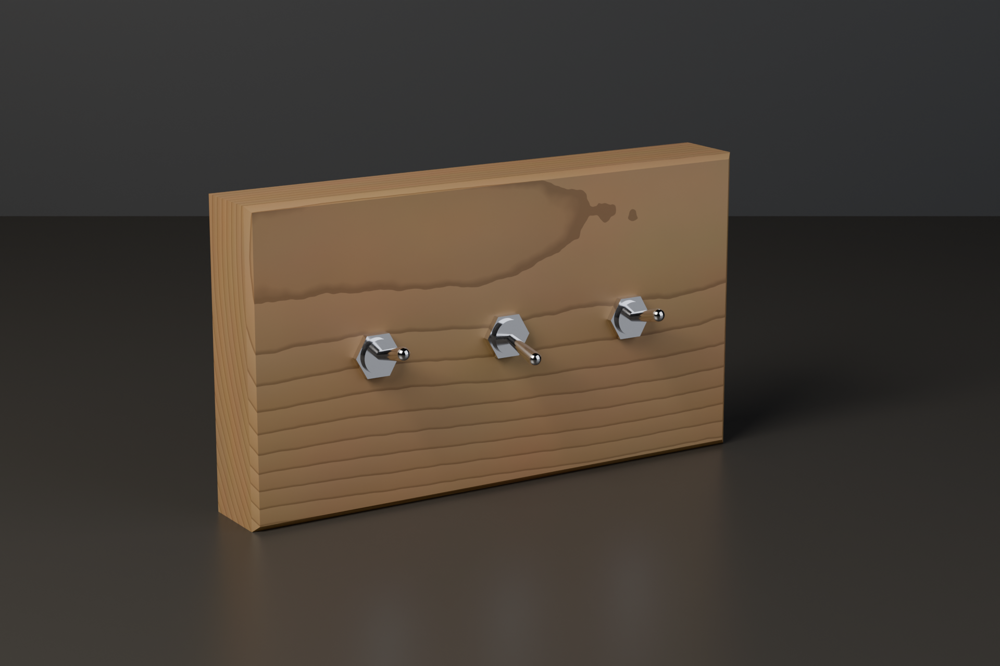
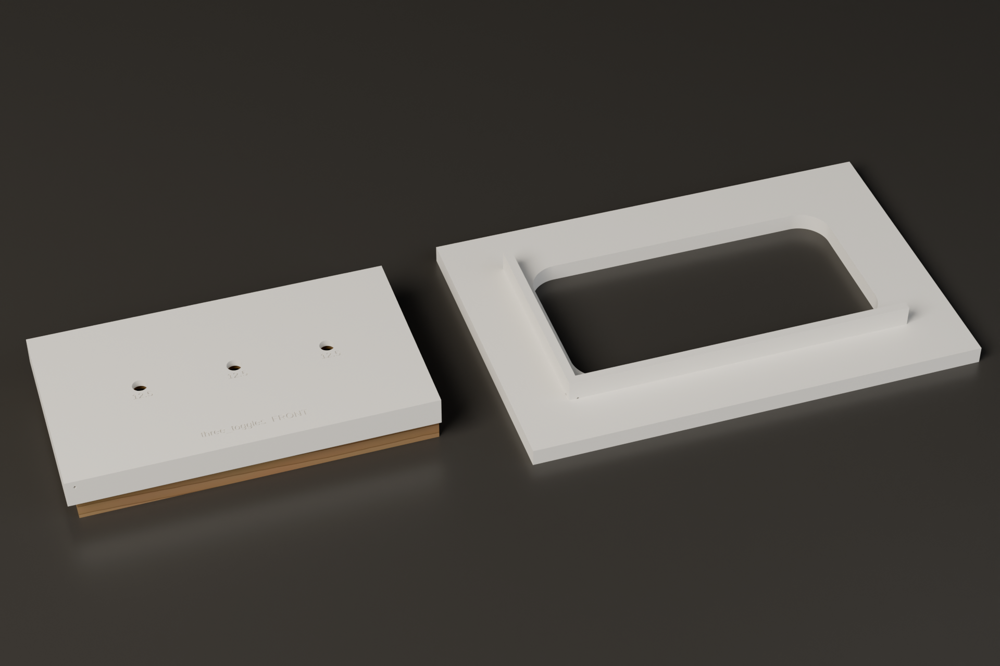
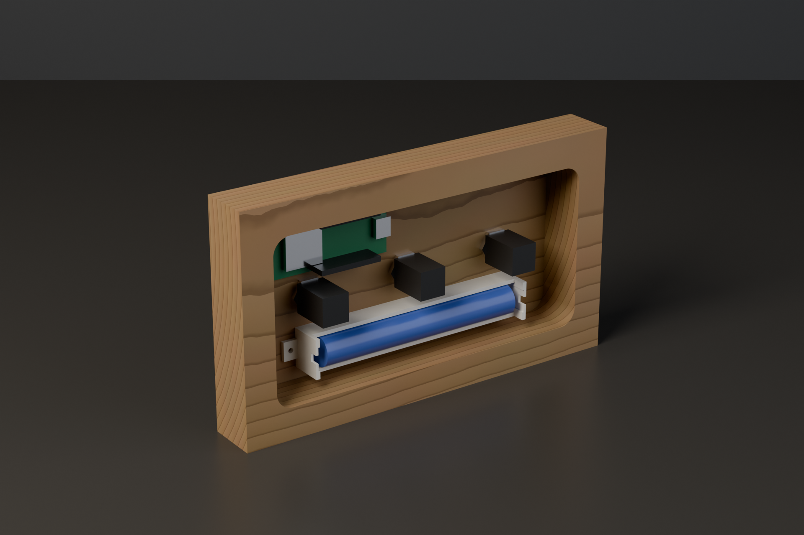

# Vippa



*Concept render, generated from the CAD by `scripts/render_hero.py` (see
the hero-render skill); regenerate, never edit.*

Rugged Home Assistant controls made from a solid piece of hardwood or
brass, with real retro toggle switches, rotary knobs, pilot lamps and
analog meters set into it. An ESP32-H2 running ESPHome and two AA cells
sit in a cavity behind the face; no cable. It talks Zigbee, so a flip
reaches Home Assistant at once instead of after a wifi reconnect. Open hardware and firmware.

Status: the first panel, an oak slab with three toggles, is designed
but not yet built. The toggle dimensions in the catalog are placeholders
until measured on real parts. Firmware follows the hardware.

## Made with hand tools

No CNC needed. Every panel comes with two printed templates that
register on fences along two edges of the board:

- a punch template for the front: seat it, center punch every hole
  through its bores, then drill from the marks
- a router template for the back: a router with a guide bushing routes
  the cavity that thins the face for the switch bushings and holds the
  electronics





## Your own panels

A panel is a small JSON file in `panels/`. This is the first one:

```json
{
  "description": "First panel: an oak slab with three full size toggles centered in a row, on two AA cells",
  "board": {"w": 190, "h": 107, "t": 27, "chamfer": 2, "material": "oak"},
  "cavity": {"face_t": 4, "rim": 15, "r": 8},
  "components": [
    {"id": "left", "type": "toggle_12mm", "x": 45, "y": 53.5},
    {"id": "middle", "type": "toggle_12mm", "x": 95, "y": 53.5},
    {"id": "right", "type": "toggle_12mm", "x": 145, "y": 53.5}
  ],
  "internals": [
    {"id": "battery", "type": "battery_2aa_holder", "x": 95, "y": 30},
    {"id": "esp", "type": "esp32_devboard", "x": 135, "y": 77}
  ]
}
```

Positions are millimetres from the bottom left corner seen from the
front. Components go through the face; internals (the ESP32 board and
the battery) lie in the cavity behind it. Types come from
`catalog/components.json`. The pipeline checks every panel before it
renders anything: the face thin enough for the bushings, the cavity
deep and wide enough for the switch bodies, board and battery, nothing
behind the face crowding anything else, no metal in front of the
radio antenna, neighbours far enough apart, the templates within the
print bed and the router bit able to make the cavity corners.

Your tools go in `cad/design_params.scad`: center punch, guide bushing,
router bit and print bed.

## Calibration first

Print `cad/calibration/punch_guide_gauge.scad`, try your center punch in
each bore and set `punch_clearance` in `cad/design_params.scad` to the
tightest bore it slides through without wobble.

## Working on the design

Everything is driven from one script:

```bash
python3 scripts/regen_all.py           # checks, then every template into build/
python3 scripts/regen_all.py --check   # read-only gate, what CI runs
python3 scripts/render_hero.py         # the README images (Blender, minutes)
```

`build/panels/<name>/` gets `punch_template.stl`, `router_template.stl`,
quick preview renders and `<name>.scad`, which opens the panel in
OpenSCAD. OpenSCAD and Blender come from nix; without nix, point
`OPENSCAD` and `BLENDER` at your own binaries. The scripts are standard
library Python.

## License

MIT, see `LICENSE`.
