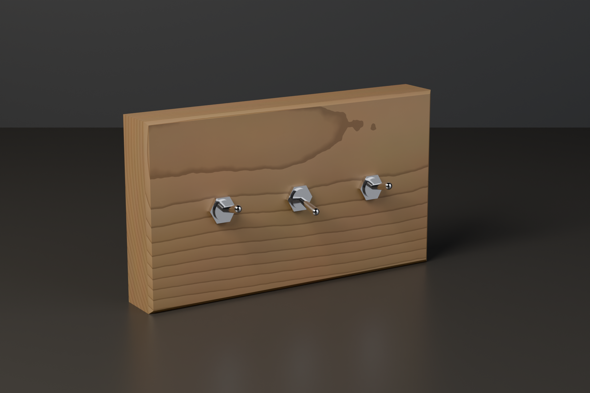
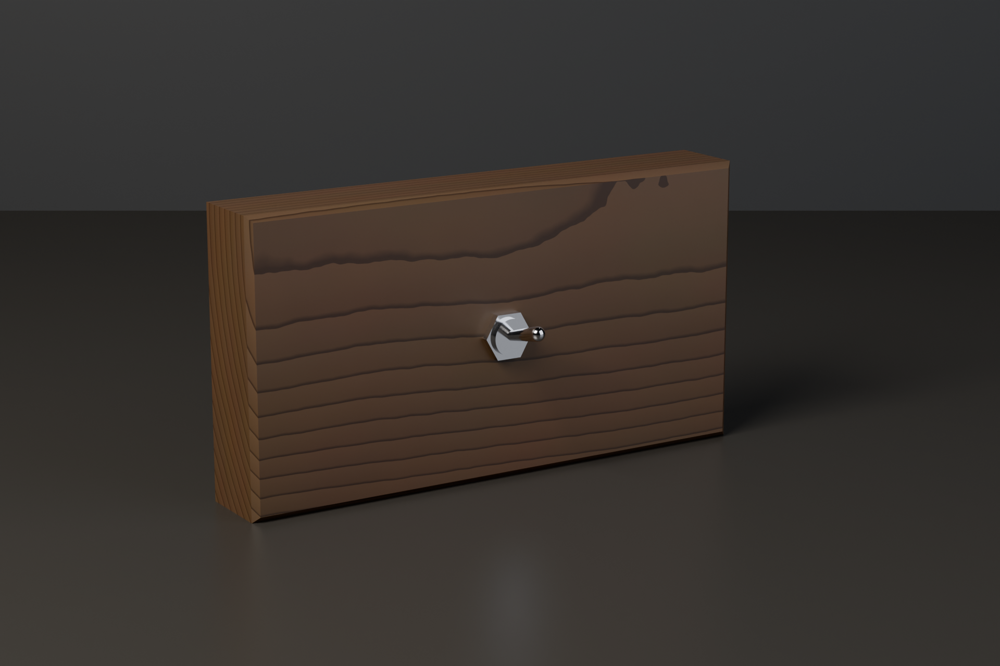
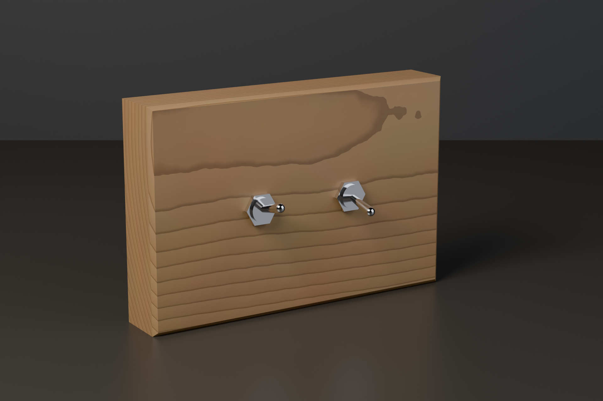
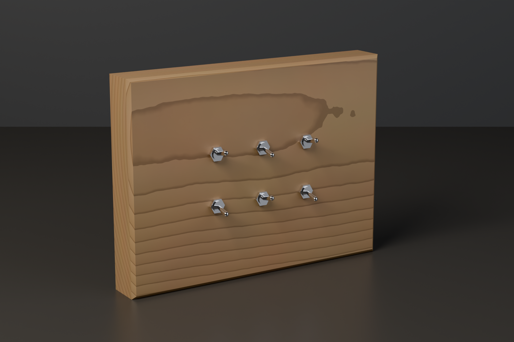
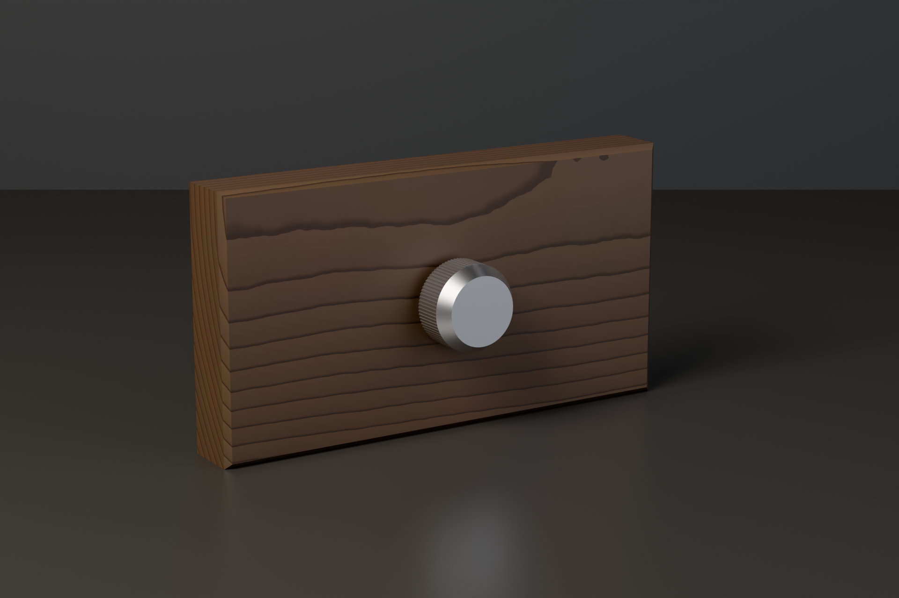
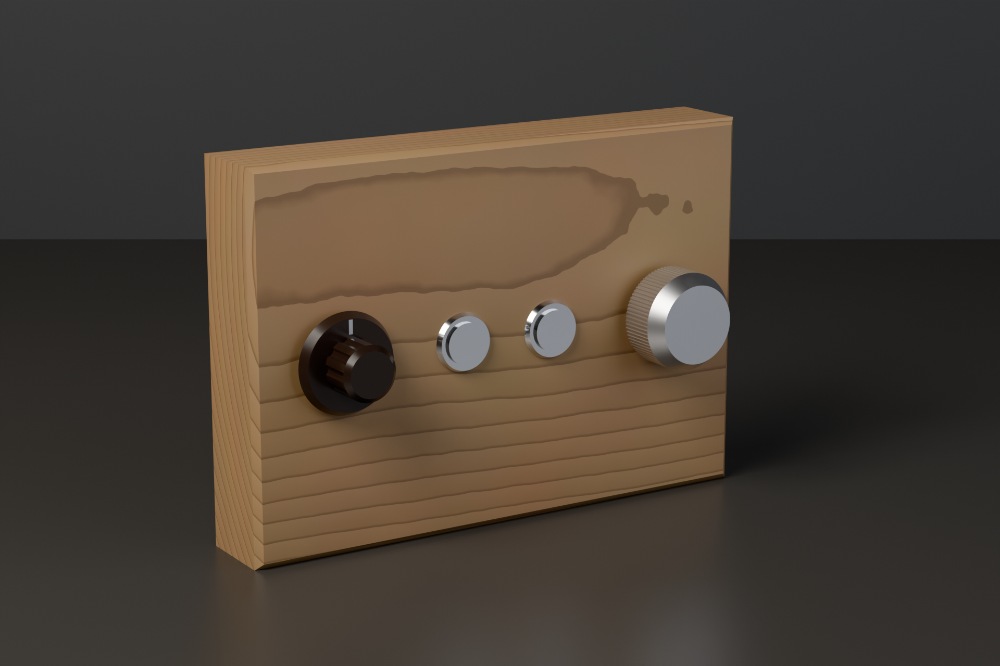
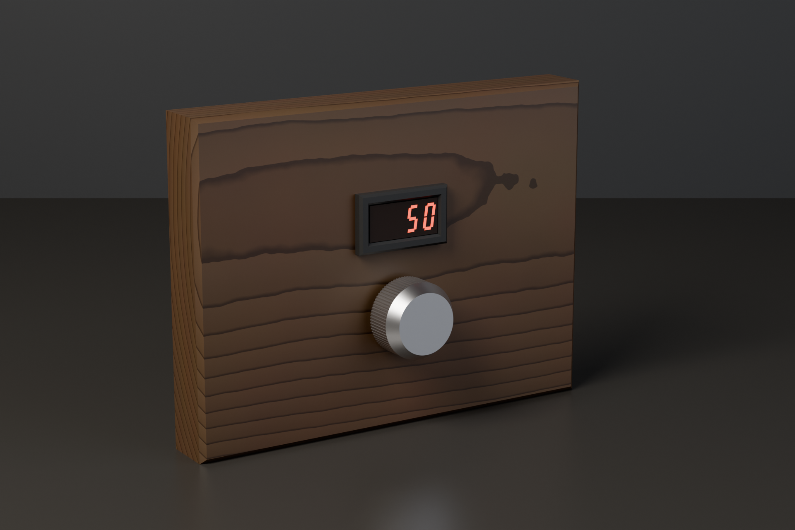
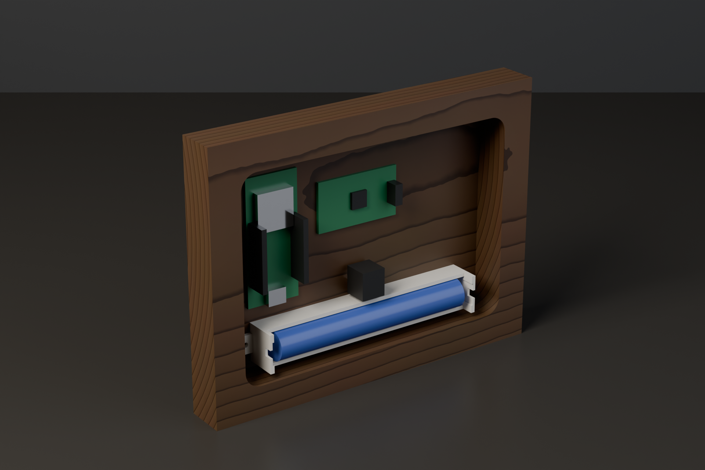

# Vippa


*Concept render, generated from the CAD by `scripts/render_hero.py` (see
the hero-render skill); regenerate, never edit.*

Rugged Home Assistant controls made from a solid piece of hardwood or
brass, with real retro toggle switches, rotary knobs, pushbuttons and
LED segment readouts set into it. An ESP32-H2 running ESPHome and two AA cells
sit in a cavity behind the face; no cable. It talks Zigbee, so a flip
reaches Home Assistant at once instead of after a wifi reconnect. Open hardware and firmware.

Status: the first panel, an oak slab with three toggles, is designed
but not yet built. Toggles, encoder knobs, rotary switches,
pushbuttons and an LED segment display are in the catalog, all with
placeholder dimensions until measured on real parts. The ESPHome firmware is generated from the
panel and validated, but not yet flashed on a real ESP32-H2.

## Made with hand tools

No CNC needed. Every panel comes with two printed templates that
register on fences along two edges of the board:

- a punch template for the front: seat it, center punch every hole
  through its bores, then drill from the marks
- a router template for the back: a router with a guide bushing routes
  the cavity that thins the face for the switch bushings and holds the
  electronics


## Your own panels

A panel is a small JSON file in `panels/`. This is the first one:

```json
{
  "description": "First panel: an oak slab with three full size toggles centered in a row, on two AA cells",
  "board": {"w": 190, "h": 107, "t": 27, "chamfer": 2, "material": "oak"},
  "cavity": {"face_t": 4, "rim": 15, "r": 8},
  "components": [
    {"id": "left", "type": "toggle_12mm", "x": 45, "y": 53.5, "pin": 10},
    {"id": "middle", "type": "toggle_12mm", "x": 95, "y": 53.5, "pin": 11},
    {"id": "right", "type": "toggle_12mm", "x": 145, "y": 53.5, "pin": 12}
  ],
  "internals": [
    {"id": "battery", "type": "battery_2aa_holder", "x": 95, "y": 30},
    {"id": "esp", "type": "esp32_devboard", "x": 135, "y": 77}
  ]
}
```

Positions are millimetres from the bottom left corner seen from the
front. Components go through the face; internals (the ESP32 board and
the battery) lie in the cavity behind it. Types come from
`catalog/components.json`. The pipeline checks every panel before it
renders anything: the face thin enough for the bushings, the cavity
deep and wide enough for the switch bodies, board and battery, nothing
behind the face crowding anything else, no metal in front of the
radio antenna, neighbours far enough apart, the templates within the
print bed and the router bit able to make the cavity corners.

A component may name its ESP32-H2 GPIO with `"pin"`; without one it
gets the next free pin in a fixed order (`PIN_ORDER` in
`scripts/panels.py`), so wire the controls in that order. An encoder
takes three pins (push, A, B), and a rotary switch reads a resistor
ladder on one ADC pin (docs/adr/0005-pins-for-knobs.md). A display
takes two (CLK, DIO), after the pins that can wake the panel
(docs/adr/0007-pins-for-displays.md).

A display (`led_segment_4d`) is placed under `components` like a knob.
It shows through a window routed through the face from the back, with
a step plate dropped into the router template, and a printed bezel
from `cad/bezels/` on the face around it
(docs/adr/0006-display-window-routed-through.md). It shows the value of
a knob on the panel, `"shows"` or the first one, lit for a few seconds
after a turn, a press or a flip.

Your tools go in `cad/design_params.scad`: center punch, guide bushing,
router bit and print bed.

## Example panels

Ready to print and build as they are, each in `panels/`. Every one
has its controls on the board center lines and the smallest board the
checks allow around them.

- `three_toggles`: the first panel, three lights or rooms. Oak,
  190 x 107 x 27 mm, three full size toggles in a row.

  

- `bedside`: a bedside or desk lamp switch. Walnut, 175 x 93 x 27 mm,
  one full size toggle, the ESP32 board beside it.

  

- `hallway`: hall and stairs lights. Oak, 162 x 107 x 27 mm, two full
  size toggles in a row.

  

- `scenes`: room scenes (morning, day, evening, movie, dinner, night).
  Oak, 166 x 123 x 22 mm, six miniature toggles in two rows of three.

  

- `dimmer`: a lamp dimmer, turn to dim and push to switch. Walnut,
  170 x 91 x 22 mm, one encoder knob.

  

- `living_room`: scenes and brightness. Oak, 165 x 115 x 27 mm, a row
  of a scene selector (rotary switch), two pushbuttons (apply the
  scene, all off) and a brightness knob (encoder).

  

- `thermostat`: a set point with a readout. Walnut, 170 x 128 x 22 mm,
  an LED segment display above an encoder knob; turn the knob and the
  display shows its value for a few seconds, then goes dark. From the
  back: the display module behind its window, the ESP32 board beside
  it and the battery below the knob.

  

  

The pictures come from `python3 scripts/render_hero.py --panels`.

## Calibration first

Print `cad/calibration/punch_guide_gauge.scad`, try your center punch in
each bore and set `punch_clearance` in `cad/design_params.scad` to the
tightest bore it slides through without wobble.

## Working on the design

Everything is driven from one script:

```bash
python3 scripts/regen_all.py           # checks, then every template into build/
python3 scripts/regen_all.py --check   # read-only gate, what CI runs
python3 scripts/render_hero.py         # the README images (Blender, minutes)
python3 scripts/render_hero.py --panels # one picture per example panel
```

`build/panels/<name>/` gets `punch_template.stl`, `router_template.stl`
(and `router_step.stl` on a panel with a display), quick preview
renders, `<name>.scad`, which opens the panel in
OpenSCAD, and `<name>.yaml`, the panel's ESPHome config (see the
firmware skill). OpenSCAD, Blender and ESPHome come from nix; without
nix, point `OPENSCAD`, `BLENDER` and `ESPHOME` at your own binaries. The scripts are standard
library Python.

## License

MIT, see `LICENSE`.
